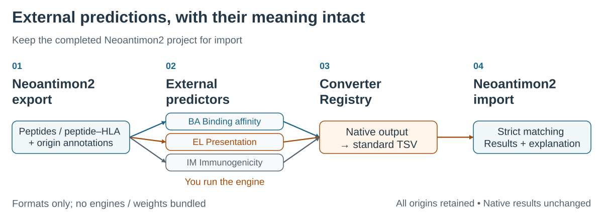

# Converter figure reference

The [README](README.md) explains the complete user workflow inline. This page
maintains the figure and its scientific/source mapping.



[SVG](docs/assets/converter-workflow.svg) · [PNG](docs/assets/converter-workflow.png) ·
[Vector PDF](docs/assets/converter-workflow.pdf) ·
[Editable draw.io](docs/assets/source/converter-workflow.drawio)

## Read the figure

1. **Export:** the completed Neoantimon2 project supplies unique peptide/pMHC
   queries and all candidate-Origin annotations. Native prediction/grades need
   not be available. Keep that project for import.
2. **External predictors:** the user runs the chosen tool separately. BA is
   binding affinity; EL is eluted-ligand/presentation modeling; IM is immunogenicity
   modeling. These are distinct metrics, not interchangeable scores.
3. **Converter Registry:** a reviewed adapter changes the output format to the
   standard TSV. It does not execute the engine or bundle models/weights. Nine
   adapters/eight families are listed in the catalog, deliberately outside this
   small diagram. Source outputs/model invocation must still be retained.
4. **Import:** `neo_analyze_external()` matches strictly against the original
   completed project. `neo_external_results()` / `neo_external_explain()` expose
   separate external assessment and every matched original Origin. Native
   evidence/grades/ranks remain unchanged.

Arrows show the processing sequence, not automatic execution. The header preserves
the required completed-project context. Three labeled branches distinguish BA,
EL and IM without relying on color. Raw IM scores are not EL percentiles or
automatic somatic A–E grades. Missing scores are not zero or evaluated negatives.

Converter/import tests used **SCHEMA_FAITHFUL_SYNTHETIC_FIXTURE** output. Upstream
predictor execution, model accuracy and clinical performance were not validated.
This simplification omits ID lists and policy thresholds, not their requirements.

## Scientific source mapping

| Connection | Authority |
| --- | --- |
| Completed project → queries/all origins | Released core `R/external_export.R` / `neo_export_bundle()` |
| Native output → exact standard TSV | Immutable converter directories, PROVENANCE.json, [catalog](CATALOG.md) |
| Strict matching and retained origins | Released core `R/external_predictions.R`; [integration test](tests/integration/released_v030.R) |
| Separate results/ranking, native immutability | Released core `R/external_analysis.R`; the same integration test hashes native artifacts |
| ID/SHA pins and explicit consent | Released core `R/external_registry.R`, `R/external_converter.R`; [security reference](MAINTAINERS.md) |

Authoritative core is immutable [v0.3.0 / eca5f06](https://github.com/hase62/Neoantimon2/tree/eca5f06fc39c1275f1e4f47ba3886f532fb08a6b).
The standard importer also supports peptide-only evidence; these nine adapters
emit peptide+HLA records. Exact Class II pairs and the catalog's no-context/allele
constraints still apply.

## Rebuild and edit

Open the uncompressed draw.io source in a local diagrams.net editor to change
individual labels, boxes and connectors. SVG retains vector text/shapes and has
no external fonts/scripts/images. The renderer uses Python's standard library;
Chrome/Chromium is optional for PNG/PDF and size previews. No predictor needed.
It reuses the core figure's reviewed renderer/style; it supports a deliberately
small subset of draw.io primitives, not arbitrary diagram plugins.

```sh
python3 tools/build_workflow_figure.py \
  --source docs/assets/source/converter-workflow.drawio \
  --output docs/assets/converter-workflow.svg
# Optional exports with an existing Chrome/Chromium installation:
python3 tools/build_workflow_figure.py \
  --source docs/assets/source/converter-workflow.drawio \
  --output docs/assets/converter-workflow.svg \
  --png docs/assets/converter-workflow.png \
  --pdf docs/assets/converter-workflow.pdf \
  --work-dir /path/to/new/local-preview
```

The main SVG is 1200 × 760; PNG is 3600 × 2280. Full-size and 1200/900/600 px
previews must be inspected after changes. At 600 px, open the full-size figure
for small adapter names; text descriptions remain accessible independently.
The Pages builder stages only the explicitly reviewed figure files/guide;
it never runs this renderer, a converter or an upstream prediction engine.
